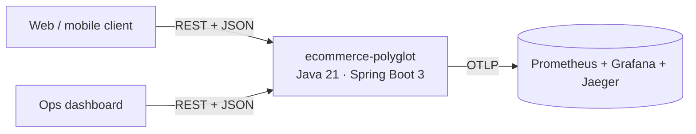
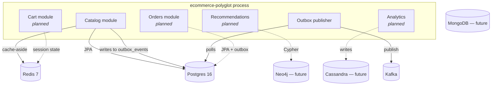
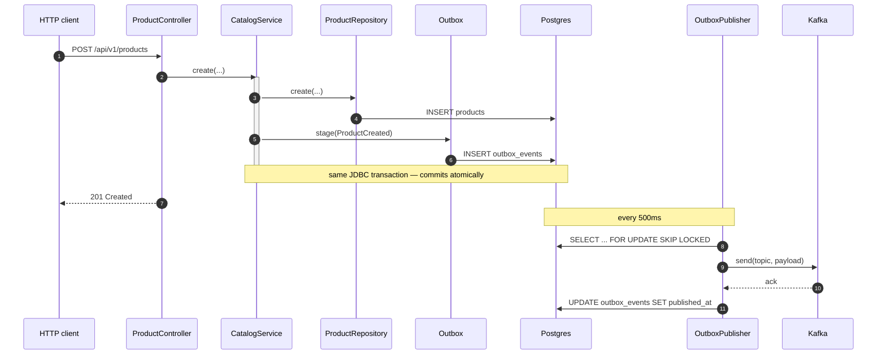
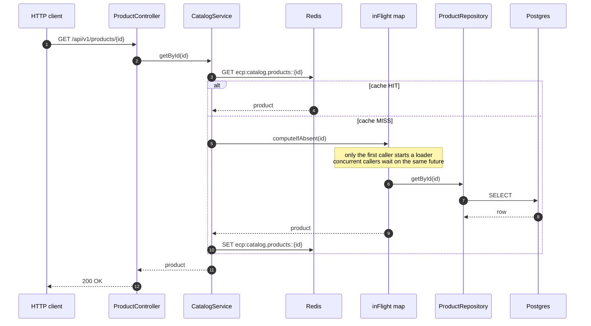

# Architecture

## C4 — Level 1: System Context



## C4 — Level 2: Containers



## C4 — Level 3: Catalog module internals

```mermaid
graph TB
    api[ProductController<br/>REST]
    service[CatalogService<br/>@Transactional + @Cacheable]
    repo[ProductRepository<br/>anti-corruption layer]
    jpa[ProductJpaRepository]
    outboxLib[Outbox<br/>shared.outbox]
    cache[(Redis cache<br/>catalog.products)]
    pg[(Postgres — catalog_db)]

    api --> service
    service -->|read hit| cache
    service -->|read miss<br/>+ singleflight| repo
    repo --> jpa --> pg
    service -->|stage event<br/>same TX as write| outboxLib
    outboxLib -->|INSERT outbox_events| pg
    service -->|CacheEvict| cache
```

## Write flow (creation)



## Read flow (cache-aside + singleflight)



## Storage-to-context mapping

See [ADR 0002](adr/0002-polyglot-persistence-mapping.md).

## Consistency model

- **Within a context**: strong (single Postgres transaction).
- **Across contexts**: eventual, mediated by domain events published via the outbox. Consumers must be idempotent (see ADR 0003).
- **Product cache invalidation**: local pod on write (@CacheEvict); other pods on consumed event within one poll interval (~500 ms). Stock reads for order placement bypass the cache and go straight to Postgres.
